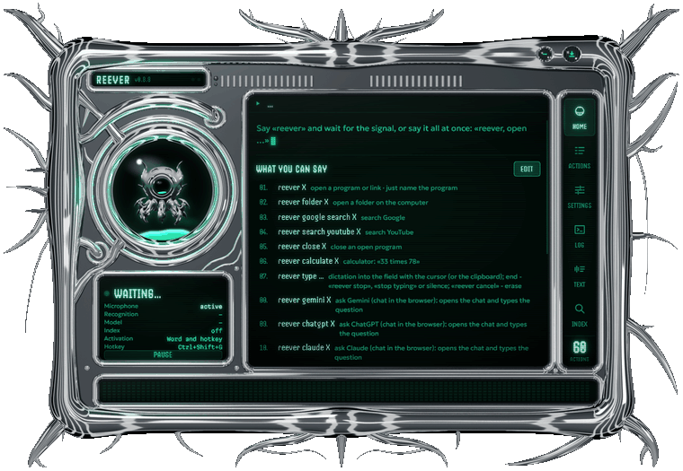
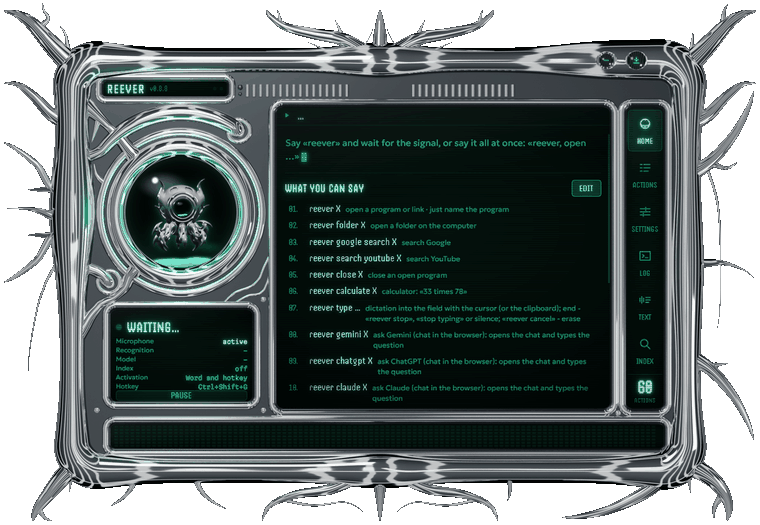
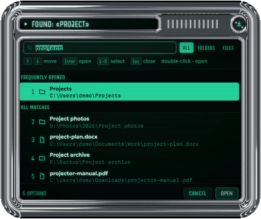
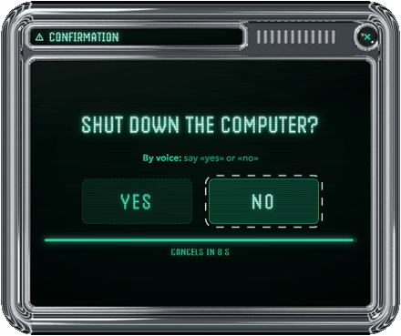
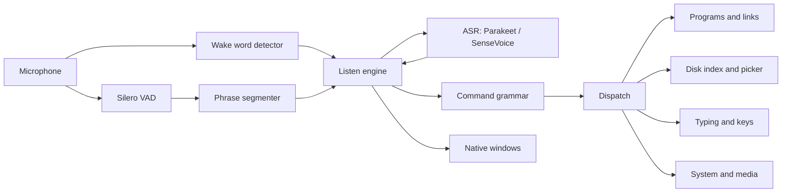

<p align="center">
  
</p>

<h1 align="center">Reever</h1>

<p align="center">
  An offline voice launcher for Windows.<br>
  Say "reever", then what you want. Speech never leaves your computer.
</p>

<p align="center">
  
  
  
  
  
  
</p>

<p align="center">
  <a href="#install">Install</a> ·
  <a href="#what-you-can-say">Commands</a> ·
  <a href="#benchmarks">Benchmarks</a> ·
  <a href="#privacy">Privacy</a> ·
  <a href="#build-from-source">Build</a>
</p>

<p align="center">
  
</p>

Reever lives in the tray and waits for its name. You say "reever, open photoshop", "reever folder downloads" or "reever search youtube lofi radio", and it does it. It opens programs and links, finds files on your disks, types what you dictate, turns any audio into text, asks ChatGPT, Claude or Gemini, counts in the Windows calculator, presses keys and controls music.

Everything is recognized on your own machine with sherpa-onnx models. There is no account, no cloud and no audio upload. Reever is written in Rust, and its windows are drawn directly with Direct2D, so it does not run a browser engine in the background.

## Contents

- [What it can do](#what-it-can-do)
- [What you can say](#what-you-can-say)
- [Music in Nemora](#music-in-nemora)
- [Your own actions](#your-own-actions)
- [Finding files and folders](#finding-files-and-folders)
- [Questions before risky commands](#questions-before-risky-commands)
- [Dictation](#dictation)
- [Speech to text](#speech-to-text)
- [The mascot](#the-mascot)
- [The window](#the-window)
- [Languages](#languages)
- [Activation and hotkeys](#activation-and-hotkeys)
- [Privacy](#privacy)
- [Updates](#updates)
- [Benchmarks](#benchmarks)
- [Install](#install)
- [Configuration files](#configuration-files)
- [Build from source](#build-from-source)
- [How it works](#how-it-works)
- [Credits](#credits)

## What it can do

| Feature | What it does |
|---|---|
| Launch | programs, games, links and folder shortcuts by name, with or without a verb |
| Find | any file or folder on your disks through its own index, with a picker window you can type in |
| Close | open programs politely ("close") or by force ("kill") |
| Search the web | Google, YouTube, or any site you add as a URL template |
| Ask AI | opens ChatGPT, Claude or Gemini in your browser and types the question |
| Dictate | types into whatever field has the cursor, phrase by phrase, with punctuation |
| Transcribe | audio and video files, or whatever your computer is playing right now |
| Calculate | opens the Windows calculator and enters the expression |
| Press keys | single keys and shortcuts: "press enter", "press alt tab", "press f5" |
| Control the PC | play/pause, next and previous track, replay, mute, shut down, restart |
| Play music | if the Nemora player is installed: songs, artists, albums and playlists by name, shuffle, likes, volume, repeat, seeking |

All of it works hands free after the wake word, or with a push-to-talk hotkey if you prefer silence in the room.

## What you can say

The defaults below are English. Every phrase, including the wake word itself, can be changed on the Home tab under "What you can say", and changes apply right away without a restart.

| Say | What happens |
|---|---|
| `reever photoshop` | runs your action named Photoshop. No verb needed |
| `reever open notepad` · `reever launch steam` | the same, if you like a verb |
| `reever folder downloads` | opens a folder from the disk index |
| `reever find report` · `reever find file report` · `reever find folder music` | shows matching files and folders in a picker |
| `reever index` | opens the index search to type in |
| `reever google search best pizza nearby` | searches Google |
| `reever search youtube lofi hip hop radio` | searches YouTube |
| `reever close discord` | closes a program like the X button would |
| `reever kill notepad` | ends a program like Task Manager does |
| `reever calculate 33 times 78` | answers in the Windows calculator |
| `reever type ...` | dictation into the field with the cursor |
| `reever listen` | writes down what the computer is playing |
| `reever chatgpt ...` · `reever claude ...` · `reever gemini ...` | asks the chat in your browser |
| `reever press ctrl shift s` | presses a key or a shortcut |
| `reever pause music` · `reever next track` · `reever previous track` · `reever replay` | music in any player through the media keys. "replay" starts the current track again |
| `reever mute sound` | mutes the sound |
| `reever shut down computer` · `reever restart computer` | asks "yes or no" first |
| `reever cancel` · `reever stop` | drops the current command |

You can say it in one breath ("reever, open downloads") or with pauses ("reever", wait for the sound, "open downloads"). A command whose target is already known runs after 0.3 s of silence instead of waiting for the full pause.

## Music in Nemora

If the [Nemora](docs/nemora.md) music player is installed, Reever notices it by itself and a group of music commands appears under "What you can say". Nothing has to be turned on in either app. Remove Nemora and the commands disappear again, without a restart.

| Say | What happens |
|---|---|
| `reever play song X` | the song, then the whole library in Smart Shuffle |
| `reever play artist X` · `reever play album X` · `reever play playlist X` | an artist shuffled, an album or a playlist in order |
| `reever play music` · `reever pause music` | resume or pause Nemora |
| `reever smart shuffle` · `reever shuffle` · `reever shuffle off` | shuffle modes |
| `reever like song` | adds the playing song to favorites |
| `reever what's playing` | the artist and title appear in the mascot's bubble |
| `reever volume 50` · `reever volume up` · `reever volume down` | Nemora's own volume, not the Windows one |
| `reever repeat song` · `reever repeat all` · `reever repeat off` | repeat modes |
| `reever play next X` | puts X right after the current song |
| `reever skip forward` · `reever rewind` | seeks 15 s, or as much as you say |

Song titles are matched by sound too, so an English title recognized in Cyrillic letters still finds the right track, and an unrelated song is never played instead. What follows a song, how artists and albums are ordered and the volume step are set in Settings, Nemora.

## Your own actions

<p align="center">
  
</p>

An action is a name plus something to open: a program, a shortcut, a link, a Steam game or a folder. Add them on the Actions tab by hand, or press Scan to pick from the programs installed on your computer, with their icons.

Each action has its own phrases. If Reever hears your pronunciation of a name differently from how it is spelled, press Calibrate and say the name a few times. Reever stores what the model actually heard, so "fl studio" can also match "fl come" and "fl studio" said with an accent.

Custom searches work the same way: add any site with a `{q}` URL template (for example `https://github.com/search?q={q}`) and a phrase to trigger it.

## Finding files and folders

<p align="center">
  
</p>

Reever keeps its own index of your disks. The first build takes a few seconds in the background after the first start, and after that it follows changes as they happen. "reever folder X" opens the best folder at once, and "reever find X" shows a picker with frequently opened items on top.

The picker has a search field, so you can keep typing when the voice was not enough. It understands the same syntax as Everything:

| Query | Meaning |
|---|---|
| `annual report` | both words somewhere in the name |
| `ext:pdf` | only PDF files |
| `folder:` · `file:` | only folders or only files |
| `photo\|image` | either word |
| `wfn:notes.txt` | the whole file name |
| `startwith:proj` | names that start with the text |

Arrows, PageUp, PageDown, Enter and Esc work from the field, digits 1 to 9 pick a row. Transliteration and fuzzy matching are on, so a name in another alphabet or a slightly misheard word is still found. The index can be turned off in Settings, File search.

## Questions before risky commands

<p align="center">
  
</p>

Shutting down and restarting always ask first. Answer "yes" or "no" by voice or click a button. If nobody answers, the question cancels itself when the countdown ends. The same question can be turned on for closing and ending programs in Settings.

## Dictation

"reever type ..." starts dictation into whatever has the text cursor: a browser field, a chat, Word, a code editor. Reever types each phrase after a short pause, and with "Type while speaking" it types word by word. Dictation ends after silence (3 s by default), on "stop typing", or when you say a new command with the wake word.

Options in Settings, Dictation:

- punctuation and capitals from the model, or plain text
- an ellipsis where your speech trails off, after a pause you choose
- when there is no text field, the text goes to the clipboard instead
- for Cyrillic languages, English words can be written in Latin letters

## Speech to text

<p align="center">
  
</p>

There are two ways to turn speech into text, both offline.

The Text tab takes a file. Drop an audio or video file onto the window or choose one (mp3, m4a, wav, flac, wma, mp4, mov, mkv and other formats Windows can decode), tick the languages spoken in it, and get the text with paragraphs. One minute of m4a decodes in about 0.2 s.

"reever listen" takes the computer sound. It captures what plays in your speakers or headphones (a video, a call, a podcast) and shows the text growing in a small monitor in the corner of the screen. It stops after a few seconds of silence (3 to 10 s, or only on command), on "reever stop" which keeps the text, or on "reever cancel" which throws it away. The result lands on the Text tab and in the clipboard.

## The mascot

<p align="center">
  
</p>

The octopus lives in the sphere of the main window. When you start a command it comes out through a portal to the corner of the screen, shows what it hears in a speech bubble, and goes back when the command is done. You can keep it on screen always, only during commands, or never, scale it from 100 to 500 percent, and pin it anywhere you like.

## The window

The main window is a fixed skin with a chrome frame, in the spirit of media player skins from the 2000s. The sphere lights up while Reever listens, and particles fly around it. Tabs on the right:

| Tab | What is there |
|---|---|
| Home | status, live text of the command, and the editable list "What you can say" |
| Actions | your actions, phrases, voice calibration, the program scanner |
| Settings | interface, mascot, activation, privacy, recognition, languages, dictation, file search, system |
| Log | what was heard and what was done |
| Text | file and computer sound transcription |
| Index | search the disk index by typing |

There is also a Lite interface: a plain rounded window without the frame and the mascot, for slower computers or a quieter look. Animation smoothness can be set to the monitor rate, 60 or 30 frames per second. The window works with the keyboard alone and with screen readers through UI Automation.

## Languages

Reever understands 29 languages: English, Russian, Ukrainian, German, French, Spanish, Italian, Portuguese, Polish, Czech, Slovak, Bulgarian, Croatian, Slovenian, Dutch, Danish, Swedish, Finnish, Estonian, Latvian, Lithuanian, Greek, Hungarian, Romanian, Maltese, Chinese, Cantonese, Japanese and Korean.

English is built in. The other languages come in packs that the installer downloads when you tick them:

| Pack | Languages | Model | Download |
|---|---|---|---:|
| built in | English | Parakeet TDT 110M | in the installer |
| European | 24 European languages | Parakeet TDT 0.6B v3, 4-bit | 601 MB, or 367 MB for the light variant |
| Asian | Chinese, Cantonese, Japanese, Korean | SenseVoice Small, 4-bit | 146 MB, or 118 MB for the light variant |
| Language ID | picks the language of each phrase | Whisper base | about 198 MB |

When two languages are on, you can mix them in one phrase: give commands in one language and say names in the other.

The interface is translated into 30 languages, including Arabic with a right-to-left layout. It follows the Windows language by default and can be switched in Settings, Interface, along with the tray menu.

## Activation and hotkeys

In Settings, Activation, choose how Reever starts listening:

| Mode | How it works |
|---|---|
| `both` (default) | the wake word or the hotkey |
| `wake` | only the wake word |
| `hotkey` | only push-to-talk. In idle the microphone is not recognized at all |

The push-to-talk hotkey is Ctrl+Shift+G by default. A second hotkey mutes the microphone instantly. Both can be any key or combination and apply without a restart.

The wake word detector is a small network trained for "reever". In Settings you can fit it to your voice, or let it adapt quietly from the first commands you say.

## Privacy

- Recognition runs on your computer. Audio and text are not sent anywhere and are not written to disk. The audio buffer lives in memory and is overwritten after use.
- Pause and the mute hotkey close the microphone stream for real, so Windows shows that no app is using the microphone.
- Private log hides recognized text and search queries from the log.
- Offline mode turns off web search, the AI chats and the update check. Reever then makes no network requests at all.
- DLLs are loaded only from System32 and the app folder, which protects against DLL hijacking.

A wake word needs constant listening, like any voice assistant. The difference is that here it all stays on the device. If you do not want any listening in idle, use the `hotkey` mode.

## Updates

On every start and then every 6 hours Reever asks GitHub for the latest release. A new version is downloaded, its SHA-256 is checked, and a small notice offers to install it. With automatic updates on, Reever installs it by itself when it is idle and nobody is at the computer. Nothing is sent except the version number in the User-Agent. Updates can be turned off in Settings, System.

## Benchmarks

All numbers below were measured on 2026-11-22 with Reever 0.8.8 on one machine: AMD Ryzen 7 7800X3D, 32 GB RAM, NVMe SSD, Windows 11. Speech recognition runs on the CPU. The commands to reproduce them are at the end of the section, and the full reports are in [`testdata/`](testdata).

### Voice commands

The whole pipeline (VAD, phrase segmenter, listen engine, recognition, command grammar) on a synthetic corpus of 166 recorded phrases. The voices are Windows SAPI and RHVoice voices, so this is a regression test rather than a study of real people. Most phrases are Russian speech, 46 of them have English targets. Model: Parakeet TDT 0.6B v3, int8.

| Scenario | Phrases | Right command |
|---|---:|---:|
| Command in one breath ("reever spotify") | 34 | 33 |
| Pause after the wake word | 12 | 12 |
| Pause after the verb, or inside the name | 14 | 14 |
| English commands | 28 | 28 |
| English names said with a strong Russian accent | 16 | 14 |
| Close and kill programs | 16 | 16 |
| Calculator | 16 | 16 |
| Yes or no to a question | 8 | 8 |
| Search query after a pause | 6 | 6 |
| Speech without the wake word, must be ignored | 16 | 16 ignored |
| Total | 166 | 163 (98%) |

"Right command" includes 23 phrases where the command was right but a name came out with a small spelling difference, like "photoшоp" for "photoshop". Fuzzy matching usually still finds the action in such cases.

| Measurement | Result |
|---|---:|
| Average time from the end of speech to the command | 427 ms |
| Processing time per second of audio (real time factor) | 0.20 s |
| Model load | 1.7 s |

### Wake word

The detector that ships in the app, on synthetic voices of 24 languages, saying "River" and the local spelling of it, alone and before a command, at two speeds.

| Measurement | Result |
|---|---:|
| "reever" detected | 243 of 272 (89%) |
| False triggers on ordinary speech | 1 of 99 phrases |
| 100% detected | English, Russian, Italian, Polish, Czech, Slovak, Slovenian, Serbian, Danish, Latvian, Hungarian, Romanian |
| 88 to 96% | German, French, Spanish, Portuguese, Dutch, Chinese |
| 75 to 81% | Ukrainian, Swedish, Finnish, Greek |
| Weak | Korean 3 of 8, Cantonese 1 of 8 |

If the detector misses your voice, fit it to your voice in Settings, Activation. It learns from a few recordings of you saying "reever".

### File search

Searches in the disk index of the installed copy, 513,861 entries (the folders worth searching on drive C:). The time is the search call itself, with fuzzy matching and transliteration.

| Query | Time |
|---|---:|
| `downloads` | 4.3 ms |
| `annual report` | 14.2 ms |
| `projekt` (misspelled) | 1.2 ms |
| `screenshots` | 5.3 ms |

### Memory and CPU

| Measurement | Result |
|---|---:|
| Installed 0.8.8 idling in the tray, main window open, wake word on, English and Russian | 264 MB working set |
| CPU in the same state, average over 60 s | 8.8% of one core, 0.55% of the whole CPU |
| Idle in 0.8.5, measured after the disk index fix | about 123 MB, about 3% of one core |
| Main window, from creation to the first frame | 235 ms |
| Installer with the English model | 117 MB |

The native interface replaced a WebView2 one in 0.7.3. With the mascot and its bubble on screen, memory went from about 495 MB in 8 processes to about 74 MB in one.

### Speech to text

A 60 second m4a file in English and Russian (measured on 2026-11-08): decoding 0.17 s, loading the models 1.5 s, recognition 4.5 s.

### Reproduce

```bash
cd src-tauri
cargo run --release --example eval              # voice commands -> testdata/eval-report.md
cargo run --release --example wake_lang_eval    # wake word      -> testdata/wake-lang-report.md
cargo run --release --example find_probe -- any "annual report"
cargo run --release --example transcribe_file -- <file>
```

The eval corpus is generated by `scripts/gen-corpus.ps1`.

## Install

1. Download `Reever_x.y.z_x64-setup.exe` from [Releases](../../releases) and run it.
2. Pick the interface languages and tick the language packs you want. They are downloaded during the install and checked by SHA-256.
3. Start Reever. Its icon appears in the tray.
4. On the first start the octopus introduces itself, and Reever builds the disk index in the background.

Then say "reever, open ..." and go.

Windows SmartScreen may warn about the installer, because it is not signed with a code signing certificate yet. Click "More info", then "Run anyway".

## Configuration files

All settings live in `%APPDATA%\com.troid.reever\` as plain files you can edit:

| File | What it is |
|---|---|
| `actions.json` | your actions and their phrases |
| `grammar.json` | the wake word, command phrases and custom searches |
| `settings.json` | everything from the Settings tab |
| `aliases.json` | aliases for folders and programs |
| `sounds/<pack>/` | sound packs: `start.wav`, `received.wav`, `success.wav`, `error.wav`. Add your own folder to make a new pack |
| `reever.log` | the log |

Files are created from built-in defaults on the first start. Delete one and it comes back with defaults. Downloaded language packs are kept in `%LOCALAPPDATA%\com.troid.reever\models\` and survive updates.

## Build from source

You need Windows 10 or 11, [Rust](https://rustup.rs/), [Python 3](https://www.python.org/), and [NSIS 3](https://nsis.sourceforge.io/) for the installer.

```bash
powershell -ExecutionPolicy Bypass -File scripts/fetch-deps.ps1   # speech models, about 160 MB
cd src-tauri && cargo run                                        # development build
python tools/build_installer.py                                  # installer -> src-tauri/target/release/bundle/nsis/
```

The first step matters: the speech models are not stored in git. Without them the build still passes, but Reever cannot hear anything, so the script checks the result and exits with code 1 if a model is missing. Add `-Packs european,asian,lid` to fetch the language packs for development.

Tests and the voice pipeline benchmark:

```bash
cd src-tauri
cargo test --lib                                # unit tests
cargo test --lib -- --ignored                   # the same on real models
cargo run --release --example eval              # whole pipeline on the synthetic corpus
cargo run --release --example eval -- --noise-db -30
```

More for contributors is in [CONTRIBUTING.md](CONTRIBUTING.md) (in Russian), and the voice pipeline contract is in [docs/voice-pipeline.md](docs/voice-pipeline.md).

## How it works



- Audio comes in through cpal and is resampled with rubato. Silero VAD cuts speech into phrases, and the wake word detector listens all the time.
- The listen engine is a state machine without side effects: wake, command, confirmation, dictation, calibration. It is tested on its own and measured on a synthetic corpus.
- Recognition uses sherpa-onnx: Parakeet TDT for English and European languages, SenseVoice for Chinese, Japanese and Korean, Whisper base to tell languages apart. Models are loaded when needed and unloaded after an idle time you choose.
- The disk index is Reever's own: a full walk with `FindFirstFileExW`, then live updates through `ReadDirectoryChangesW`. Matching uses transliteration and fuzzy comparison (strsim).
- The windows are native: Direct2D, DirectWrite and DirectComposition through windows-rs, with no WebView. The tray icon and its menu are Reever's own as well.

## Credits

Reever is made by 46psy4.

Speech models come from NVIDIA (Parakeet), FunAudioLLM (SenseVoice), OpenAI (Whisper) and Silero (VAD), run through [sherpa-onnx](https://github.com/k2-fsa/sherpa-onnx). Licenses of every shipped component are listed in [THIRD-PARTY-NOTICES.md](THIRD-PARTY-NOTICES.md).
